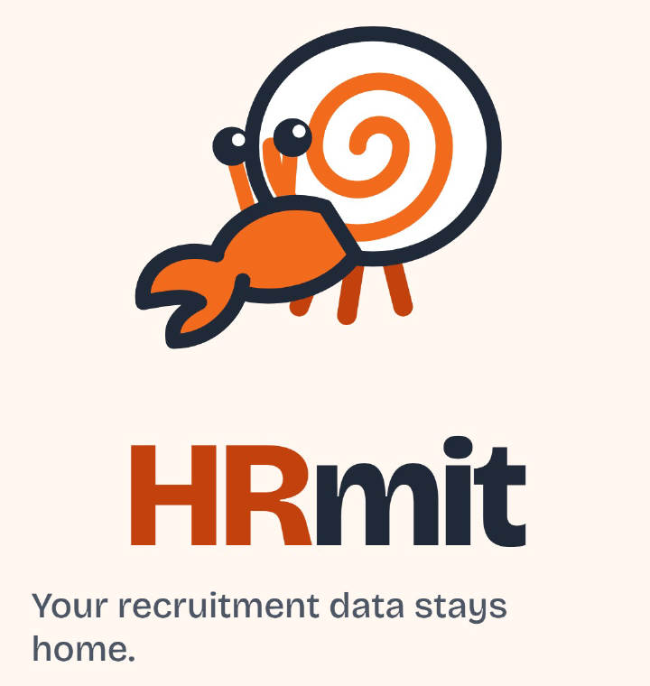
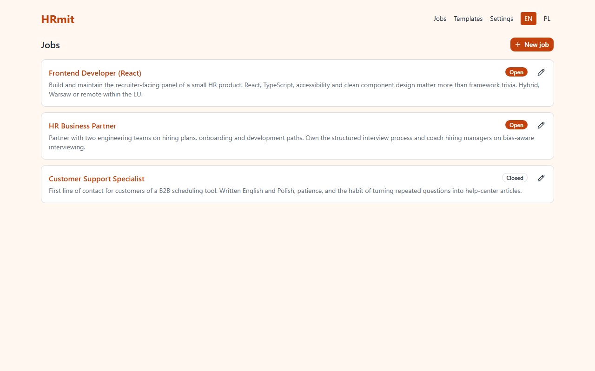
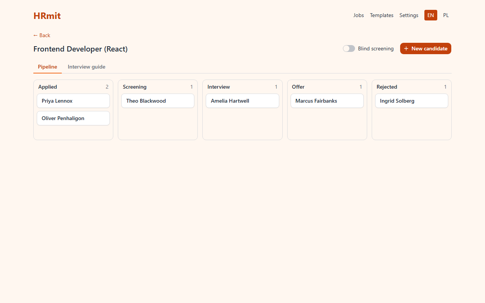
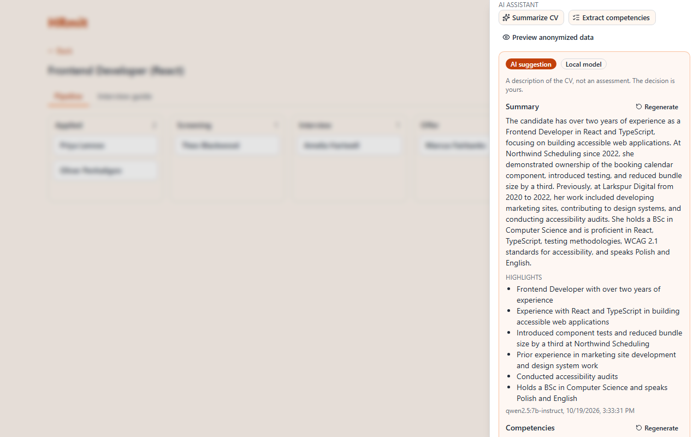
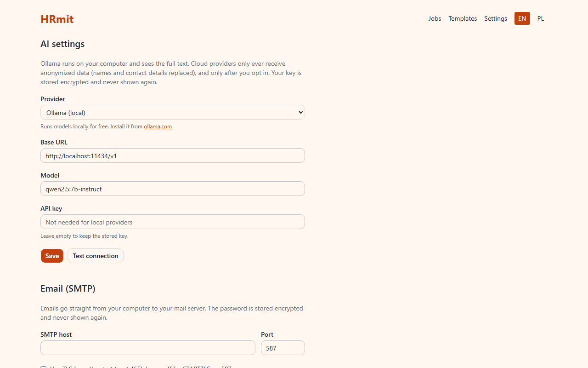

<p align="center">
  <picture>
    <source media="(prefers-color-scheme: dark)" srcset="apps/web/public/brand/lockup-dark.png" />
    
  </picture>
</p>

<p align="center">
  Local-first applicant tracking system with an AI assistant.<br/>
  Download it, run it, open <code>localhost</code>. Candidates never leave your machine.
</p>

<p align="center">
  <a href="https://github.com/pawelrozanski/HRmit/actions/workflows/ci.yml"></a>
  <a href="LICENSE"></a>
  <a href="CHANGELOG.md"></a>
</p>

## What it does

- **Recruitments and candidates** with a kanban pipeline: applied → screening → interview → offer / rejected. Drag cards, or use the stage select for keyboard use.
- **CV upload** (PDF, DOCX, validated by magic bytes) with text extraction, stored on your disk.
- **Import from CV**: a new candidate's name, email and phone prefilled from the uploaded CV by the local model (or a regex fallback), for you to check.
- **Employees and teams**: the hiring side with positions, duties and a team lead per team; a recruitment can be assigned to a team and filtered by it. Employees are never sent to an AI provider.
- **Employee notes**: plain-text notes on an employee (availability, agreements, preferences) with an optional title, added and read in a dialog, newest first, deleted with the employee.
- **AI assistant** that summarizes a CV, extracts competencies and proposes structured interview questions per job. It describes; it never scores, ranks or rejects.
- **Structured interviews**: one editable question list per job, grouped by competency, the same for every candidate.
- **Scorecards** with identical criteria, averages per competency, never a single ranking number. Works in **blind-screening** mode, which hides names and contact details.
- **Email templates** (invitation, reminder, rejection) sent as plain text over your own SMTP, with a per-candidate history.
- **Interview invites** with a Jitsi room link and an `.ics` attachment.
- **AI provider settings**: local Ollama by default, bring-your-own-key cloud (Anthropic or any OpenAI-compatible API) as an opt-in, with an anonymization preview showing exactly what would leave the machine.
- English and Polish UI, light and high-contrast dark theme, keyboard navigation (skip link, arrow-key settings tabs, focus rings).

## Screenshots

Fictional candidates from the built-in fixtures, local build, light mode.

| Jobs                                    | Pipeline                                        |
| --------------------------------------- | ----------------------------------------------- |
|  |  |

| Candidate drawer with an AI summary from a local model | Settings                                   |
| ------------------------------------------------------ | ------------------------------------------ |
|     |  |

## Why local?

Recruitment data is some of the most sensitive data a small company holds, and most ATS products are SaaS. HRmit runs on your computer: a SQLite file and an uploads folder, nothing else. Backup is "copy the folder", deletion is "delete the candidate" and the file goes with it.

AI works the same way. The default model runs on your machine through [Ollama](https://ollama.com). If you choose a cloud model, you paste your own key, and every CV is anonymized locally before it is sent; you can see exactly what leaves.

## Design decisions

- **AI assists, never judges.** It summarizes, extracts competencies and proposes questions. It cannot rank, score or reject anyone: the output schemas have no field for it. Recruitment AI is high-risk under the EU AI Act, and GDPR art. 22 limits automated decisions. The decision is always yours. ([ADR 0004](docs/adr/0004-ai-assistant-not-judge.md))
- **Local by default, cloud by choice, anonymized always.** ([ADR 0005](docs/adr/0005-byok-anonymization.md))
- **The demo is the real app.** The same frontend is built with a flag that swaps the backend for a browser-side mock. No separate mock-up to drift. ([ADR 0003](docs/adr/0003-demo-mode-msw.md))
- **One language, one repo.** TypeScript end to end, with types flowing from the server's routes into the UI. ([ADR 0001](docs/adr/0001-stack.md))
- **SQLite, no database server.** ([ADR 0002](docs/adr/0002-sqlite.md))
- **MIT.** ([ADR 0006](docs/adr/0006-license-mit.md))

Full picture in [docs/ARCHITECTURE.md](docs/ARCHITECTURE.md); the review notes are in [docs/SECURITY.md](docs/SECURITY.md) and [docs/ACCESSIBILITY.md](docs/ACCESSIBILITY.md).

## Demo

A clickable demo with fictional candidates lives at **https://pawelrozanski.github.io/HRmit/**. It is the same app built with `VITE_DEMO=true`: a service worker in your browser answers every API call from fixtures and keeps your changes in `localStorage`. Nothing is sent anywhere; AI answers are pre-recorded. "Reset demo" in the banner restores the fixtures.

## Getting started

Requirements: [Node 24+](https://nodejs.org) and pnpm (`npm install -g pnpm`).

```bash
git clone https://github.com/pawelrozanski/HRmit.git
cd HRmit
pnpm install
pnpm dev
```

Open http://localhost:5173. The API runs on `127.0.0.1:3000` and is not reachable from other machines. Data lands in `./data/` (database, uploads, master key), which is gitignored.

**AI features (optional):** install [Ollama](https://ollama.com) and pull the default model:

```bash
ollama pull qwen2.5:7b-instruct
```

Then press "Test connection" in Settings → AI settings. Any other Ollama model name works; cloud providers are configured on the same page.

**Docker Compose (alternative):**

```bash
docker compose up --build
```

Serves the built app on http://127.0.0.1:3000 with `./data` mounted as the data folder. Ollama on the host is reached through `host.docker.internal`; the compose file sets that as the default base URL and adds the `extra_hosts` entry Linux needs. The Docker files were written for 0.1.0 but could not be run on the development machine, which has no Docker; please report problems.

Other commands: `pnpm test`, `pnpm lint`, `pnpm typecheck`, `pnpm build`, `pnpm build:demo`, `pnpm --filter @hrmit/web e2e` (Playwright smoke test of the demo build, needs `pnpm --filter @hrmit/web exec playwright install chromium` once).

## Configuration

Environment variables of the server, all optional:

| Variable            | Default                     | Meaning                                                                                          |
| ------------------- | --------------------------- | ------------------------------------------------------------------------------------------------ |
| `HRMIT_DATA_DIR`    | `./data`                    | Folder for `hrmit.db`, `uploads/` and `master.key`. Back it up as a whole.                       |
| `PORT`              | `3000`                      | API port.                                                                                        |
| `HOST`              | `127.0.0.1`                 | Bind address. Keep loopback; the Docker image sets `0.0.0.0` inside the container only.          |
| `OLLAMA_BASE_URL`   | `http://localhost:11434/v1` | Default AI base URL when none is stored in Settings (the container uses `host.docker.internal`). |
| `HRMIT_LOG_PROMPTS` | unset                       | `1` logs AI prompts, in their anonymized form only, for debugging.                               |

Everything else (provider, model, key, SMTP, email templates) is edited in the UI and stored in the database, secrets encrypted. Language and theme (light, dark, system) live under Settings → General and are kept in the browser's `localStorage`.

## Security model

Short version; the full review is in [docs/SECURITY.md](docs/SECURITY.md).

- **Single user on localhost.** The server binds to loopback and has no login. Requests whose `Origin` or `Host` is not loopback are rejected, which blocks cross-site posts and DNS rebinding. Do not expose the port.
- **Secrets encrypted at rest** with AES-256-GCM and a master key in `data/master.key`. Caveat: whoever can read `data/` has both the database and the key; the encryption protects backups, screenshots and logs, not the disk.
- **Logs redact secrets** and never contain request bodies; prompts are logged only on request and only anonymized.
- **Uploads** are allowlisted by extension and magic bytes, 10 MB, stored under random names, served by id.
- **Anonymization is heuristic.** Structured fields and common patterns are replaced; a name that appears only in free text can slip through to a cloud provider. Stay local if that matters.

## Roadmap and out of scope

Stages 0 to 11 of [docs/ROADMAP.md](docs/ROADMAP.md) are shipped as 0.1.0, CV import, the settings sidebar and the dark theme as 0.2.0, employees and teams as 0.3.0, employee notes as 0.3.1, titled notes in dialogs as 0.3.2; see [CHANGELOG.md](CHANGELOG.md). Tracked but not planned: inbound applications over IMAP, Google Meet, a desktop installer, multi-user with authentication, a local NER model for anonymization, stage history and audit log.

Issues and pull requests are welcome; please keep commits small and follow Conventional Commits.

## License

[MIT](LICENSE) © 2026 Paweł Różański
