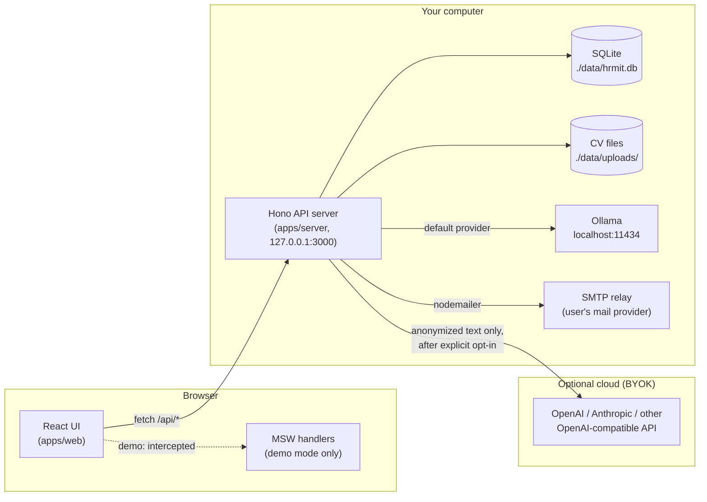
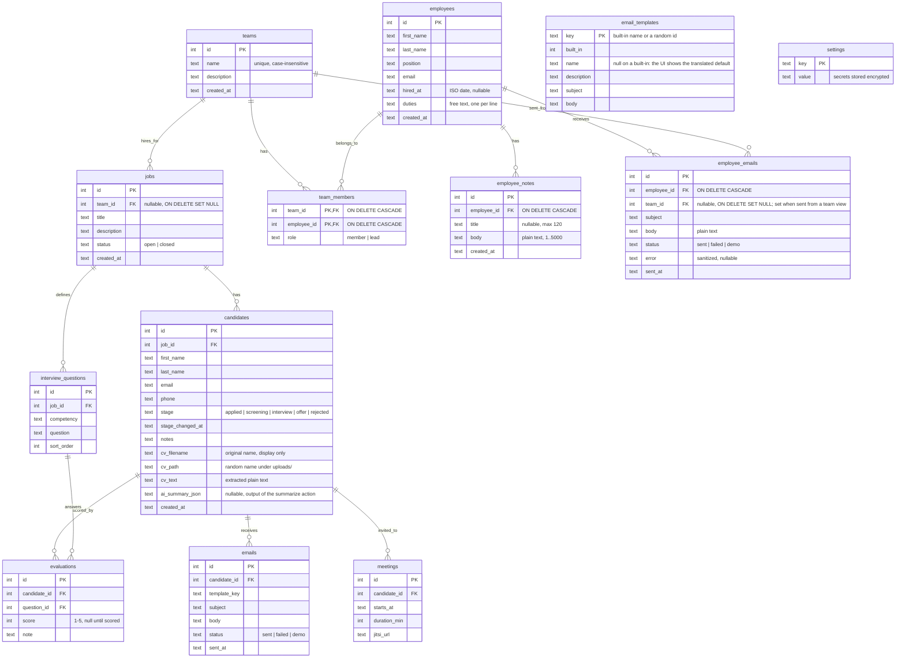
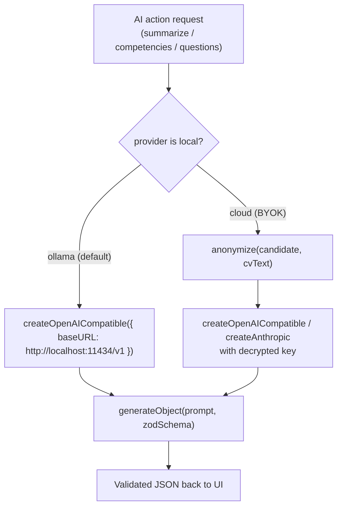
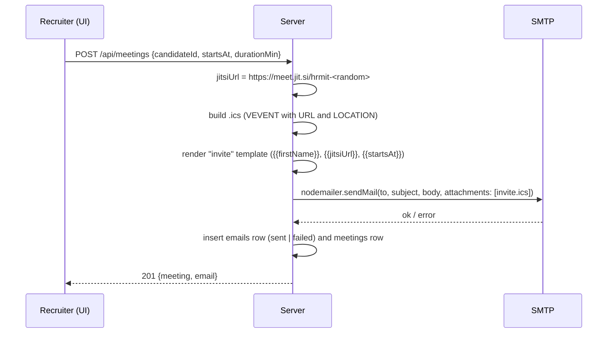

# HRmit architecture

HRmit is a local-first applicant tracking system (ATS) with an AI assistant. You download it, run it, and get a panel on `localhost`. Candidate data never leaves your machine unless you explicitly enable a cloud AI provider, and even then it is anonymized first.

This document describes the target architecture for the MVP. Decisions with trade-offs are recorded in [`adr/`](adr/). The delivery order is in [`ROADMAP.md`](ROADMAP.md).

## 1. System overview



Two deployables, one codebase:

| Mode                    | How it runs                                                                                                | Data                        | AI                                                           |
| ----------------------- | ---------------------------------------------------------------------------------------------------------- | --------------------------- | ------------------------------------------------------------ |
| **Local** (the product) | `pnpm dev` starts the API server and the Vite dev server; the production build is served by the API server | SQLite + files in `./data/` | Ollama by default, cloud via BYOK                            |
| **Demo** (GitHub Pages) | Static build with `VITE_DEMO=true`; no server at all                                                       | Fixtures in `localStorage`  | Pre-recorded responses from JSON, shown with a typing effect |

## 2. Monorepo layout

```
HRmit/
├── apps/
│   ├── web/                 # React + Vite + Tailwind + shadcn/ui
│   │   └── src/
│   │       ├── api/         # the ONE place that talks to the backend (hono/client)
│   │       ├── demo/        # MSW handlers + localStorage store, bundled only when VITE_DEMO=true
│   │       ├── features/    # jobs, candidates, pipeline, ai, settings, email, ...
│   │       ├── i18n/        # en.json, pl.json
│   │       └── pages/       # Landing (/), app routes (/demo/* on Pages, /* locally)
│   └── server/              # Hono on Node
│       └── src/
│           ├── routes/      # one file per resource, exported as a typed Hono app
│           ├── db/          # Drizzle schema + migrations
│           ├── ai/          # provider factory, prompts, zod output schemas
│           ├── mail/        # nodemailer, templates, .ics
│           └── security/    # key encryption, upload validation, log redaction
├── packages/
│   └── shared/              # zod schemas, TS types, enums, anonymize(), demo fixtures
├── docs/                    # this file, adr/, ROADMAP.md
├── data/                    # runtime data, gitignored (HRMIT_DATA_DIR overrides)
└── .github/workflows/       # ci.yml (lint, test, build), pages.yml (deploy demo)
```

Why a monorepo: the web app imports the server's route _types_ (not its code) and gets a fully typed API client for free. The shared package holds everything both sides need: validation schemas, enums like pipeline stages, the anonymizer, and the demo fixtures that also seed the local database.

## 3. Data model



Design notes:

- **Glossary: job vs recruitment.** The entity is a `job` in the database, the API (`/api/jobs`, `jobId`) and the shared schemas; the UI calls it a _recruitment_ ("Recruitments" / "Rekrutacje") since 0.3.0. Renaming the technical name would have touched every table, route and test for a label.
- **Employees are the hiring side**, never candidates: interviewers and hiring managers grouped into teams. An employee can be in several teams with one role per team (`member` or `lead`, at most one lead is a convention, not a constraint). A job may belong to one team; deleting the team leaves the job without one (`SET NULL`), deleting an employee or a team removes its memberships (`CASCADE`). Employees and their notes (`employee_notes`, optional title plus plain-text body, newest first, deleted with the employee) never reach an AI prompt. Messages sent to an employee from the panel (`employee_emails`, 0.4.0) are one row per recipient; a send from a team view stamps `team_id` and one shared `sent_at`, which is how the team page groups a send. Rows go with the employee and survive the team.
- **One CV per candidate**, stored as columns, not a separate table. A second upload replaces the first. (ponytail: add a `cv_files` table only if versioning is ever requested.)
- **Pipeline stage is a text column**, validated by a zod enum in `packages/shared`. No stage-history table in MVP; `stage_changed_at` is enough for the kanban.
- **Interview questions belong to the job, not the candidate.** This is what makes the interview _structured_: every candidate for a job gets the same questions and is scored on the same competencies. The scorecard is `evaluations` joined with the job's questions.
- **The anonymized label is derived**, never stored: `Candidate #<id>`.
- **Settings is a key-value table.** Keys like `ai.provider`, `ai.baseUrl`, `ai.model`, `ai.apiKey`, `ai.prompt.<key>`, `smtp.host`, `smtp.port`, `smtp.secure`, `smtp.user`, `smtp.pass`, `smtp.from`, `smtp.companyName`. Keys on a secret list (`ai.apiKey`, `smtp.pass`) are encrypted on write and never returned by the API, which answers `hasApiKey: true` or `hasPass: true` instead.
- **Backup and restore** (0.5.3, 0.5.4). `GET /api/backup` answers with a `.tar.gz` holding `hrmit.db` (a `VACUUM INTO` snapshot, so the WAL is folded in and the copy is consistent) and every file under `uploads/`, packed by a 40-line ustar writer in `apps/server/src/backup/tar.ts` plus `node:zlib`, no dependency; `master.key` is never included (docs/SECURITY.md). `POST /api/backup/restore` takes the same archive as a multipart file, checks it (gunzip and tar parse, `hrmit.db` present, upload names flat with no path parts, the database opens read-only, passes `PRAGMA integrity_check` and has the `jobs` and `candidates` tables), then `replaceDatabase()` in `db/index.ts` closes the `node:sqlite` handle, deletes the old file with its `-wal` and `-shm`, writes the new one, reopens it and runs the migrations and seeds again, so an older backup comes up to date; the Drizzle proxy reads the handle variable per call, so nothing else changes. The `uploads/` folder is replaced whole. The UI reloads the page afterwards since every cache is stale. The demo serves its localStorage store as one JSON file and takes it back the same way.

## 4. API layer and demo mode

### 4.1 Routes

JSON under `/api`, one Hono sub-app per resource, composed in `apps/server/src/app.ts`. The composed app's _type_ is exported and imported by the web app:

```ts
// apps/server/src/app.ts
export const app = new Hono().route('/api/jobs', jobs).route('/api/candidates', candidates)
// ...
export type AppType = typeof app

// apps/web/src/api/client.ts
import { hc } from 'hono/client'
import type { AppType } from '@hrmit/server/app'
export const api = hc<AppType>(import.meta.env.BASE_URL)
```

Calling `api.api.candidates.$get()` in the UI is type-checked against the server. Rename a field on the server and the web build fails. No hand-written API types, no OpenAPI generator.

| Resource    | Endpoints (MVP)                                                                                                                                                                                                                                                                                                                                                             |
| ----------- | --------------------------------------------------------------------------------------------------------------------------------------------------------------------------------------------------------------------------------------------------------------------------------------------------------------------------------------------------------------------------- |
| dashboard   | `GET /dashboard?stuckDays=N`: headline counts, interviews in the next 7 days, candidates waiting N days or more in a stage (default 7), missing scorecards, open jobs with a per-stage funnel, failed sends of the last 30 days. Plain queries, no AI, no contact fields in the response.                                                                                   |
| jobs        | list (filter by team), create, update, close; `teamId` must name an existing team                                                                                                                                                                                                                                                                                           |
| employees   | list (`?q=` on name or position, `?teamId=`, with teams and `noteCount`), create, get, update, delete (hard, memberships, notes and messages cascade); notes: `GET/POST /employees/:id/notes`, `DELETE /employees/:id/notes/:noteId`; messages: `GET/POST /employees/:id/emails` (newest first; 409 without SMTP)                                                           |
| teams       | list (with member and open job counts), create (409 on a duplicate name), get (members with role, jobs), update, delete (jobs keep, `teamId` null), add members, set role, remove member; messages: `GET /teams/:id/emails` (rows with the recipient's name), `POST /teams/:id/emails` (`employeeIds` must be members, else 400; one mail each; answers `{ sent, failed }`) |
| candidates  | list (filter by job and stage), create, update, delete, move stage, upload CV, download CV                                                                                                                                                                                                                                                                                  |
| ai          | `POST /ai/summarize/:candidateId`, `POST /ai/competencies/:candidateId`, `POST /ai/questions/:jobId`, `GET /ai/preview/:candidateId` (anonymized text), `POST /ai/test` (connection check), `POST /ai/chat` (streamed NDJSON answer over read-only tools, §5.3)                                                                                                             |
| questions   | list by job, update, reorder                                                                                                                                                                                                                                                                                                                                                |
| evaluations | `GET /candidates/:id/scorecard` (questions joined with evaluations), `PUT` (upsert)                                                                                                                                                                                                                                                                                         |
| emails      | list by candidate, send from template, preview                                                                                                                                                                                                                                                                                                                              |
| templates   | list, create, update, delete (custom only), restore (built-in only)                                                                                                                                                                                                                                                                                                         |
| meetings    | create (generates Jitsi link and sends the `.ics` invite)                                                                                                                                                                                                                                                                                                                   |
| settings    | get (secrets masked), update                                                                                                                                                                                                                                                                                                                                                |
| backup      | `GET /backup` (snapshot + CVs as .tar.gz), `POST /backup/restore` (the same file back)                                                                                                                                                                                                                                                                                      |

Every request body is validated with the shared zod schemas through `@hono/zod-validator`.

### 4.2 Demo mode

The web app is built twice from the same source. The only difference is one environment flag:

```ts
// apps/web/src/main.tsx
if (import.meta.env.VITE_DEMO === 'true') {
  const { startDemo } = await import('./demo') // code-split: absent from the local build
  await startDemo() // registers the MSW service worker
}
```

- **MSW (Mock Service Worker)** intercepts `fetch` calls to `/api/*` inside the browser. The React code and the API client do not know they are being mocked.
- **Handlers** in `apps/web/src/demo/handlers/` mirror the server routes and operate on an in-memory store seeded from `packages/shared/fixtures`. The store is written to `localStorage` after every mutation, wrapped in `try/catch` (private mode, quota). "Reset demo" clears the key and reloads.
- **AI responses** come from `packages/shared/fixtures/ai/*.json`, keyed by candidate or job id. Handlers return them after a short delay; the UI renders any AI text with a typing effect, so demo and real responses look the same.
- **Uploads** in demo accept the file, ignore its contents, and attach a fixture CV text.
- **Emails** in demo are recorded with `status: 'demo'` and shown in an "Outbox" view instead of being sent.
- A fixed banner reads: _Demo mode. All candidates are fictional._
- Routing: `/` is the landing page, `/demo/*` is the app. In the local build the app lives at `/*` and the landing page is not rendered. Vite `base` is `/HRmit/` for GitHub Pages.
- App routes (relative to the mount point): `/` redirects to `/dashboard`, `/dashboard` the attention board (§4.3), `/recruitments/:id` pipeline and interview guide (`/jobs/:id` redirects there), `/employees`, `/teams` and `/teams/:id`, `/settings` a layout with a vertical tab list and nested routes `general` (language, theme, about), `ai`, `email`, `prompts` (0.5.4, the prompt texts), `templates`, `backup` (0.5.3 download, 0.5.4 restore); `/settings` redirects to `/settings/general` and the old `/templates` to `/settings/templates`.

Why this counts as the same frontend and not a mock-up: the handlers are a second implementation of the API contract, validated by the same zod schemas. If a demo handler returns a wrong shape, the shared schema test fails.

### 4.3 Dashboard

The first screen after opening the panel. One request, `GET /api/dashboard?stuckDays=N`, six plain queries over SQLite, no AI: the numbers are always exactly what the tables say and the screen works without any model configured. Tiles: interviews in the next seven days (with the Jitsi link), candidates waiting N days or more in a stage of an open job (the threshold is editable on the tile and kept in `localStorage`), candidates in interview or offer whose scorecard is incomplete, open recruitments with a funnel bar (segment width follows the count, the number sits on the segment and a legend names the stages, so nothing depends on colour alone), failed sends of the last 30 days, and the headline counts. Every row links to the candidate drawer (`/recruitments/:jobId?candidate=:id`) or the employee drawer (`/employees?open=:id`). Blind screening uses the same toggle and storage key as the recruitment page. The demo computes the same shape from its store, and the fixture dates are relative to today so the demo does not go stale. ponytail: one endpoint; a tile gets its own only if it ever becomes slow.

## 5. AI providers and anonymization

### 5.1 Provider layer

One factory, driven by `settings`:



- **Vercel AI SDK** (`ai`) gives one call shape, `generateObject` with a zod schema, for every provider. The UI never sees free-form text for structured actions; it sees `{ summary, competencies[] }`.
- **Provider catalog** (`packages/shared/src/aiProviders.ts`): one entry per provider with `id`, `kind`, default `baseUrl`, a `local` flag, a short description, a few suggested model ids and the key/docs links. `ai.provider` stores the id; the settings schema accepts catalog ids only (`openai-compatible` from older databases reads as `custom`). The UI renders the catalog as a tile with the provider's logo (`simple-icons`, monogram where none exists) and a chooser dialog; the model field is free text with a `<datalist>` of the suggestions, for Ollama replaced by the installed models from `GET /api/ai/models` (`/api/tags`).
- **Two adapters cover every entry.** `kind: 'openai-compatible'` (`@ai-sdk/openai-compatible`) serves Ollama, LM Studio, OpenAI, Google Gemini, Mistral, DeepSeek, xAI, Perplexity, OpenRouter, Groq, Together AI, Fireworks AI and the custom endpoint; `kind: 'anthropic'` is `@ai-sdk/anthropic`. `createModel()` reads kind and default URL from the catalog. `isLocalProvider()` is the catalog's `local` flag, or the host check for `custom`; everything non-local is anonymized.
- **Default local model:** `qwen2.5:7b-instruct`. Fits in the 11 GB of an RTX 2080 Ti at Q4 (about 4.7 GB), follows JSON schemas well, handles Polish. Any model name can be typed in settings.
- **Prompts** are built in `apps/server/src/ai/prompts/` as plain template functions: the instruction text first, then the data (job, CV, chat context) appended by code. The instruction texts live in `packages/shared/src/aiPrompts.ts` as defaults and can be edited in Settings → AI (0.5.2): `GET/PUT /api/settings/prompts`, stored under `ai.prompt.<key>` only when they differ from the default, `{{lang}}` and `{{today}}` filled in by `renderTemplate()`. The defaults restate the product rule: _describe, do not decide_. An operator who rewrites them takes that decision on themselves; the output schemas still have no "fit score", "ranking" or "recommendation" field, so a structured action cannot return one even if asked. The chat answer is free text, so there the prompt is the only guard.

### 5.2 Anonymization (before anything leaves the machine)

Pure, deterministic, unit-tested function in `packages/shared/src/anonymize.ts`:

1. Replace every occurrence of the candidate's structured fields (first name, last name, email, phone) with `Candidate #<id>`, `[email]`, `[phone]`. Matching is case-insensitive and tolerant to diacritics (`Łukasz` matches `Lukasz`).
2. Regex pass for anything that looks like an email, phone number, URL, postal address line, date of birth, or national ID number (PESEL).
3. Photos are never sent: only extracted text is passed to AI.
4. The result is exposed through `GET /ai/preview/:id` so the user can inspect it before enabling a cloud provider, and the preview is one click away on every cloud-backed action.

Limitations are stated in the UI: this is a heuristic, not named-entity recognition. Names that appear only in the CV body (references, former managers) can slip through. A local NER model is a possible later upgrade.

Local providers (Ollama) skip anonymization: the data does not leave the machine, and the full text gives better summaries.

### 5.3 Chat assistant: tool calling (ADR 0007)

The assistant panel answers natural-language questions about the recruiter's own data. The model is never handed the database. It gets a list of seven read-only tools and decides which to call; the server runs them and returns only their results.

```mermaid
sequenceDiagram
  participant UI as Chat panel (browser)
  participant S as Server (/api/ai/chat)
  participant T as Tools (SELECT only)
  participant M as Model (Ollama or cloud)
  UI->>S: question + history + { view, id } + lang
  S->>S: cloud? scrub the recruiter's words with anonymize()
  S->>M: system prompt + history + 7 tool schemas
  M-->>S: tool call: stuckCandidates({ days: 7 })
  S->>T: run the tool (local: names; cloud: "Candidate #N", anonymized text)
  T-->>S: rows + refs { id -> name, jobId }
  S->>M: tool result
  M-->>S: text, streamed
  S-->>UI: NDJSON: tool, text…, refs, done
  UI->>UI: swap "Candidate #N" for the name (not under blind screening), link names and titles
```

- **Tools** live in `apps/server/src/ai/tools.ts` as plain async functions; their input and output zod schemas are in `packages/shared/src/chat.ts`. `listRecruitments`, `getRecruitment` and `teamOverview` accept a name as well as an id, because small models pass what the recruiter typed ("IT", "Frontend") and invent ids otherwise. The schemas are covered by the no-verdict test (no `score`/`rank`/… key) and a read-only test (row counts unchanged after running every tool).
- **Loop and limits:** `streamText` with `stopWhen: stepCountIs(5)` and `temperature: 0`. Each step is one model call; a tool call and its result count as a step. The system prompt (`apps/server/src/ai/prompts/chat.ts`, English with a language instruction, like the other prompts) states the rules: answer only from tool results, never rank or recommend, read only, never ask permission to use a tool, never invent an id, refer to people by the label a tool returned.
- **Context:** the UI sends what is open (`dashboard`, `recruitment`, `candidate` with its id); the prompt maps "this candidate" to that id and the data comes from a tool.
- **Stream:** one NDJSON line per event (`chatEventSchema`): `tool` (name, shown as a short status), `text` (delta), `refs` (names and link targets for the UI only), `error`, `done`. The AI SDK's own UI stream protocol was not used: it would add the `ai` package to the web app for five event types.
- **Tool support detection:** for Ollama the server asks `POST /api/show` for the model's `capabilities` before the first call and answers `422 { error: 'no_tools' }` when `tools` is missing (the panel links to AI settings and names models that work); for other providers a "does not support tools" error mid-stream becomes the same error event.
- **History:** kept in the browser for the session (a provider above the router), never stored. "New conversation" clears it.
- **Demo:** `POST /api/ai/chat` is answered by `apps/web/src/demo/chat.ts`, which maps the suggested questions (and a few keywords) to scenarios computed from the demo store and streams them in the same format, with a pseudo tool status and the text in pieces. Off-script questions get a note that the full chat works locally.

**How `qwen2.5:7b-instruct` behaves** (Ollama 0.9, RTX 2080 Ti, checked 2026-10-25): it calls tools reliably for single questions in English and answers cleanly. In Polish it calls the right tool but the prose after the result is often clumsy and mixed with English, and over several turns it sometimes answers from memory instead of calling a tool. Three things made it workable: accepting names in the lookup tools (it sent `teamId: "IT"`, which Ollama rejected silently and returned an empty answer), telling it never to ask permission (it asked "shall I call stuckCandidates?" instead of calling it) and removing an example id from the prompt (it copied "Candidate #14" into answers). A 14B model or English questions avoid the rest. Latency is 5 to 15 seconds per answer.

## 6. Email and meetings



- Templates live in `email_templates`. The three built-ins (`invite`, `reminder`, `rejection`) are seeded on every start, can be edited and restored to the shipped text, never deleted; custom templates (0.5.1) get a random key and can be deleted. `name` and `description` are for the recruiter and stay null on a built-in until renamed, so the UI shows the translated default and follows the language switch. Names are unique (case-insensitive check in the route, unique index underneath). `emails.template_key` is plain text with no foreign key: a deleted custom template leaves the history untouched, the UI shows subject and date only. Placeholders are substituted with a small `replace` loop; no templating library.
- The `.ics` file is a 15-line string built by hand (`BEGIN:VCALENDAR` …). No dependency.
- Jitsi needs no account and no API: a room exists the moment someone opens the URL. Google Meet is out of MVP (needs OAuth).
- SMTP credentials live in `settings`, password encrypted. A "Send test email" button validates the config.
- Every email ever sent is logged in `emails`, so the candidate page shows a communication history.
- Messages to employees and teams (0.4.0) reuse the same SMTP path and `sendMail()`: the recruiter writes subject and body (plain text, `{{firstName}}`, `{{lastName}}` and `{{companyName}}` filled in per recipient), a team send loops over the picked members and sends one mail per recipient, never a CC or BCC list, and records one `employee_emails` row each. A failed recipient does not stop the others; the answer names who failed. In the demo nothing is sent and rows get status `demo`.

## 7. Security

| Area                             | Decision                                                                                                                                                                                                                                                                                                                                                                           |
| -------------------------------- | ---------------------------------------------------------------------------------------------------------------------------------------------------------------------------------------------------------------------------------------------------------------------------------------------------------------------------------------------------------------------------------- |
| **Network**                      | Server binds to `127.0.0.1` only (`HOST` env; the Docker image uses `0.0.0.0` inside the container while compose binds the host side to loopback). No auth in MVP because nothing is reachable from outside the machine; `/api/*` rejects a non-loopback `Origin` or `Host` to block cross-site posts and DNS rebinding. Documented as a known limit; multi-user is out of scope.  |
| **Secrets at rest**              | API keys and SMTP passwords encrypted with AES-256-GCM (`node:crypto`). A random 32-byte master key is generated on first run into `./data/master.key` (mode `0600` where the OS supports it). This protects against leaking secrets through DB backups, exports, screenshots of the settings page and logs. It does _not_ protect against someone with access to the user's disk. |
| **Secrets in transit to the UI** | Never. The settings API returns `hasApiKey: boolean`.                                                                                                                                                                                                                                                                                                                              |
| **Logs**                         | Structured logger with a redaction list (`apiKey`, `pass`, `authorization`). Request bodies are not logged. AI prompts are logged only at debug level and only in their anonymized form.                                                                                                                                                                                           |
| **File upload**                  | Allowlist by extension _and_ magic bytes (PDF starts with `%PDF-`, DOCX is a ZIP containing `word/`), 10 MB limit, stored under a random UUID filename; the original name is kept only as a DB column for display. Files are served by id through the API, never by path.                                                                                                          |
| **CV parsing**                   | `unpdf` for PDF, `mammoth` for DOCX, in the server process. Parsing failures are caught and reported; the upload still succeeds with empty text.                                                                                                                                                                                                                                   |
| **Data deletion**                | `DELETE /api/candidates/:id` removes the row, its evaluations, emails, meetings and the file on disk, in one transaction. Documented as the GDPR right-to-erasure path.                                                                                                                                                                                                            |
| **Cloud AI**                     | Off by default. Enabling it shows a dialog naming the provider, the endpoint and exactly which fields are sent, with a link to the anonymization preview.                                                                                                                                                                                                                          |
| **Demo data**                    | All fixtures are fictional and written by hand. No real names, no real companies. Enforced by review, noted in `CLAUDE.md`.                                                                                                                                                                                                                                                        |
| **Supply chain**                 | `pnpm-lock.yaml` committed; CI runs `pnpm audit` as a non-blocking step.                                                                                                                                                                                                                                                                                                           |

## 8. Internationalization

- UI strings in `apps/web/src/i18n/{en,pl}.json`, loaded with `react-i18next`. Default language follows the browser, fallback `en`, switchable under Settings → General (and on the landing page); the choice is stored in `localStorage`. The theme (`light` | `dark` | `system`) is chosen on the same tab and stored under `hrmit-theme`; `data-theme` on `<html>` switches the CSS variables in `apps/web/src/index.css`.
- Code, comments, commits, docs: English.
- Demo fixtures: English only.
- AI prompts ask the model to answer in the UI language (passed as a parameter).

## 9. Glossary for the interview

- **Monorepo**: one git repository holding several packages developed together. Here: the web UI, the server, and shared code.
- **Vite**: the tool that turns TypeScript and React into a bundle the browser can run, with instant reload during development.
- **React component**: a function that returns a piece of UI. The app is a tree of them.
- **MSW**: a library that pretends to be the server inside the browser. The demo on GitHub Pages has no backend because MSW answers every API call.
- **Zod schema**: a runtime description of a data shape that doubles as a TypeScript type and as request validation.
- **Drizzle**: a thin layer for writing SQL-shaped queries in TypeScript; it also generates the database migrations.
- **BYOK**: bring your own key. The user pastes their own cloud API key; HRmit has no key of its own and no server in the middle.
