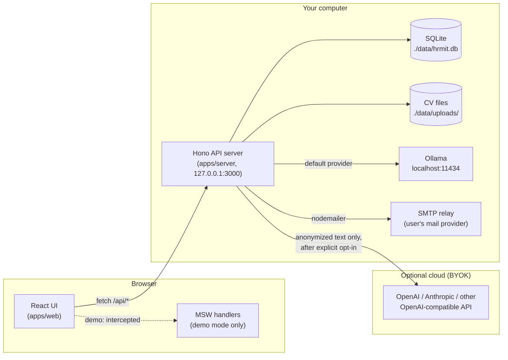
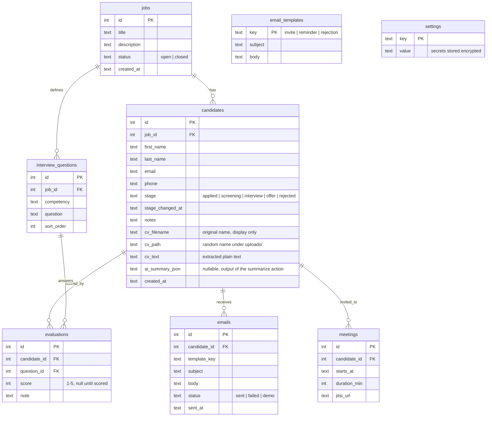
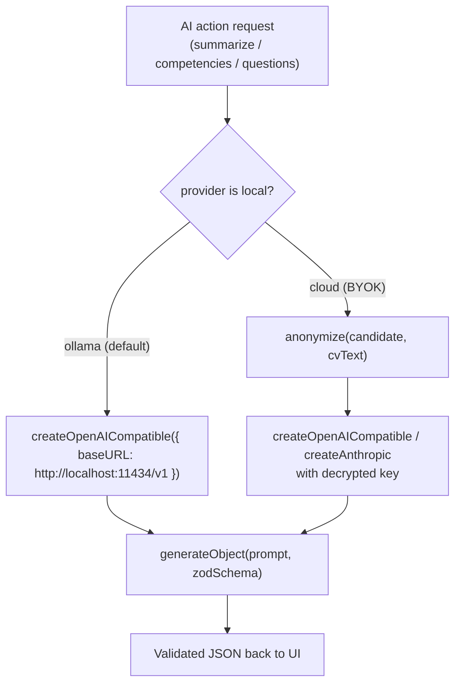
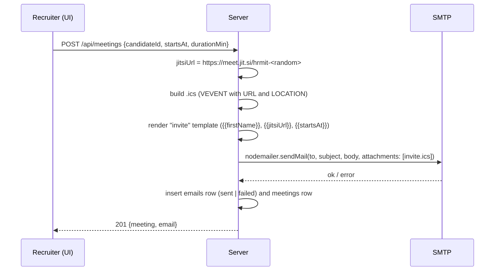

# HRmit architecture

HRmit is a local-first applicant tracking system (ATS) with an AI assistant. You download it, run it, and get a panel on `localhost`. Candidate data never leaves your machine unless you explicitly enable a cloud AI provider, and even then it is anonymized first.

This document describes the target architecture for the MVP. Decisions with trade-offs are recorded in [`adr/`](adr/). The delivery order is in [`ROADMAP.md`](ROADMAP.md).

## 1. System overview



Two deployables, one codebase:

| Mode                    | How it runs                                                                                                | Data                        | AI                                                           |
| ----------------------- | ---------------------------------------------------------------------------------------------------------- | --------------------------- | ------------------------------------------------------------ |
| **Local** (the product) | `pnpm dev` starts the API server and the Vite dev server; the production build is served by the API server | SQLite + files in `./data/` | Ollama by default, cloud via BYOK                            |
| **Demo** (GitHub Pages) | Static build with `VITE_DEMO=true`; no server at all                                                       | Fixtures in `localStorage`  | Pre-recorded responses from JSON, shown with a typing effect |

## 2. Monorepo layout

```
HRmit/
├── apps/
│   ├── web/                 # React + Vite + Tailwind + shadcn/ui
│   │   └── src/
│   │       ├── api/         # the ONE place that talks to the backend (hono/client)
│   │       ├── demo/        # MSW handlers + localStorage store, bundled only when VITE_DEMO=true
│   │       ├── features/    # jobs, candidates, pipeline, ai, settings, email, ...
│   │       ├── i18n/        # en.json, pl.json
│   │       └── pages/       # Landing (/), app routes (/demo/* on Pages, /* locally)
│   └── server/              # Hono on Node
│       └── src/
│           ├── routes/      # one file per resource, exported as a typed Hono app
│           ├── db/          # Drizzle schema + migrations
│           ├── ai/          # provider factory, prompts, zod output schemas
│           ├── mail/        # nodemailer, templates, .ics
│           └── security/    # key encryption, upload validation, log redaction
├── packages/
│   └── shared/              # zod schemas, TS types, enums, anonymize(), demo fixtures
├── docs/                    # this file, adr/, ROADMAP.md
├── data/                    # runtime data, gitignored (HRMIT_DATA_DIR overrides)
└── .github/workflows/       # ci.yml (lint, test, build), pages.yml (deploy demo)
```

Why a monorepo: the web app imports the server's route _types_ (not its code) and gets a fully typed API client for free. The shared package holds everything both sides need: validation schemas, enums like pipeline stages, the anonymizer, and the demo fixtures that also seed the local database.

## 3. Data model



Design notes:

- **One CV per candidate**, stored as columns, not a separate table. A second upload replaces the first. (ponytail: add a `cv_files` table only if versioning is ever requested.)
- **Pipeline stage is a text column**, validated by a zod enum in `packages/shared`. No stage-history table in MVP; `stage_changed_at` is enough for the kanban.
- **Interview questions belong to the job, not the candidate.** This is what makes the interview _structured_: every candidate for a job gets the same questions and is scored on the same competencies. The scorecard is `evaluations` joined with the job's questions.
- **The anonymized label is derived**, never stored: `Candidate #<id>`.
- **Settings is a key-value table.** Keys like `ai.provider`, `ai.baseUrl`, `ai.model`, `ai.apiKey`, `smtp.host`, `smtp.user`, `smtp.pass`. Keys on a secret list (`ai.apiKey`, `smtp.pass`) are encrypted on write and never returned by the API, which answers `hasApiKey: true` instead.

## 4. API layer and demo mode

### 4.1 Routes

JSON under `/api`, one Hono sub-app per resource, composed in `apps/server/src/app.ts`. The composed app's _type_ is exported and imported by the web app:

```ts
// apps/server/src/app.ts
export const app = new Hono().route('/api/jobs', jobs).route('/api/candidates', candidates)
// ...
export type AppType = typeof app

// apps/web/src/api/client.ts
import { hc } from 'hono/client'
import type { AppType } from '@hrmit/server/app'
export const api = hc<AppType>(import.meta.env.BASE_URL)
```

Calling `api.api.candidates.$get()` in the UI is type-checked against the server. Rename a field on the server and the web build fails. No hand-written API types, no OpenAPI generator.

| Resource    | Endpoints (MVP)                                                                                                                                                                            |
| ----------- | ------------------------------------------------------------------------------------------------------------------------------------------------------------------------------------------ |
| jobs        | list, create, update, close                                                                                                                                                                |
| candidates  | list (filter by job and stage), create, update, delete, move stage, upload CV, download CV                                                                                                 |
| ai          | `POST /ai/summarize/:candidateId`, `POST /ai/competencies/:candidateId`, `POST /ai/questions/:jobId`, `GET /ai/preview/:candidateId` (anonymized text), `POST /ai/test` (connection check) |
| questions   | list by job, update, reorder                                                                                                                                                               |
| evaluations | `GET /candidates/:id/scorecard` (questions joined with evaluations), `PUT` (upsert)                                                                                                        |
| emails      | list by candidate, send from template, preview                                                                                                                                             |
| meetings    | create (generates Jitsi link and sends the `.ics` invite)                                                                                                                                  |
| settings    | get (secrets masked), update                                                                                                                                                               |

Every request body is validated with the shared zod schemas through `@hono/zod-validator`.

### 4.2 Demo mode

The web app is built twice from the same source. The only difference is one environment flag:

```ts
// apps/web/src/main.tsx
if (import.meta.env.VITE_DEMO === 'true') {
  const { startDemo } = await import('./demo') // code-split: absent from the local build
  await startDemo() // registers the MSW service worker
}
```

- **MSW (Mock Service Worker)** intercepts `fetch` calls to `/api/*` inside the browser. The React code and the API client do not know they are being mocked.
- **Handlers** in `apps/web/src/demo/handlers/` mirror the server routes and operate on an in-memory store seeded from `packages/shared/fixtures`. The store is written to `localStorage` after every mutation, wrapped in `try/catch` (private mode, quota). "Reset demo" clears the key and reloads.
- **AI responses** come from `packages/shared/fixtures/ai/*.json`, keyed by candidate or job id. Handlers return them after a short delay; the UI renders any AI text with a typing effect, so demo and real responses look the same.
- **Uploads** in demo accept the file, ignore its contents, and attach a fixture CV text.
- **Emails** in demo are recorded with `status: 'demo'` and shown in an "Outbox" view instead of being sent.
- A fixed banner reads: _Demo mode. All candidates are fictional._
- Routing: `/` is the landing page, `/demo/*` is the app. In the local build the app lives at `/*` and the landing page is not rendered. Vite `base` is `/HRmit/` for GitHub Pages.

Why this counts as the same frontend and not a mock-up: the handlers are a second implementation of the API contract, validated by the same zod schemas. If a demo handler returns a wrong shape, the shared schema test fails.

## 5. AI providers and anonymization

### 5.1 Provider layer

One factory, driven by `settings`:



- **Vercel AI SDK** (`ai`) gives one call shape, `generateObject` with a zod schema, for every provider. The UI never sees free-form text for structured actions; it sees `{ summary, competencies[] }`.
- **Ollama is used through its OpenAI-compatible endpoint** (`@ai-sdk/openai-compatible`). The same provider class therefore also covers LM Studio, OpenRouter, Groq and any other OpenAI-compatible service. Anthropic gets its own provider (`@ai-sdk/anthropic`). That is the whole provider matrix.
- **Default local model:** `qwen2.5:7b-instruct`. Fits in the 11 GB of an RTX 2080 Ti at Q4 (about 4.7 GB), follows JSON schemas well, handles Polish. Any model name can be typed in settings.
- **Prompts** live in `apps/server/src/ai/prompts/` as plain template functions. Each restates the product rule: _describe, do not decide_. Output schemas have no "fit score", "ranking" or "recommendation" field, so the model cannot return one even if asked.

### 5.2 Anonymization (before anything leaves the machine)

Pure, deterministic, unit-tested function in `packages/shared/src/anonymize.ts`:

1. Replace every occurrence of the candidate's structured fields (first name, last name, email, phone) with `Candidate #<id>`, `[email]`, `[phone]`. Matching is case-insensitive and tolerant to diacritics (`Łukasz` matches `Lukasz`).
2. Regex pass for anything that looks like an email, phone number, URL, postal address line, date of birth, or national ID number (PESEL).
3. Photos are never sent: only extracted text is passed to AI.
4. The result is exposed through `GET /ai/preview/:id` so the user can inspect it before enabling a cloud provider, and the preview is one click away on every cloud-backed action.

Limitations are stated in the UI: this is a heuristic, not named-entity recognition. Names that appear only in the CV body (references, former managers) can slip through. A local NER model is a possible later upgrade.

Local providers (Ollama) skip anonymization: the data does not leave the machine, and the full text gives better summaries.

## 6. Email and meetings



- Templates (`invite`, `reminder`, `rejection`) are seeded rows in `email_templates`, editable in the UI. Placeholders are substituted with a small `replace` loop; no templating library.
- The `.ics` file is a 15-line string built by hand (`BEGIN:VCALENDAR` …). No dependency.
- Jitsi needs no account and no API: a room exists the moment someone opens the URL. Google Meet is out of MVP (needs OAuth).
- SMTP credentials live in `settings`, password encrypted. A "Send test email" button validates the config.
- Every email ever sent is logged in `emails`, so the candidate page shows a communication history.

## 7. Security

| Area                             | Decision                                                                                                                                                                                                                                                                                                                                                                           |
| -------------------------------- | ---------------------------------------------------------------------------------------------------------------------------------------------------------------------------------------------------------------------------------------------------------------------------------------------------------------------------------------------------------------------------------- |
| **Network**                      | Server binds to `127.0.0.1` only. No auth in MVP because nothing is reachable from outside the machine. Documented as a known limit; multi-user is out of scope.                                                                                                                                                                                                                   |
| **Secrets at rest**              | API keys and SMTP passwords encrypted with AES-256-GCM (`node:crypto`). A random 32-byte master key is generated on first run into `./data/master.key` (mode `0600` where the OS supports it). This protects against leaking secrets through DB backups, exports, screenshots of the settings page and logs. It does _not_ protect against someone with access to the user's disk. |
| **Secrets in transit to the UI** | Never. The settings API returns `hasApiKey: boolean`.                                                                                                                                                                                                                                                                                                                              |
| **Logs**                         | Structured logger with a redaction list (`apiKey`, `pass`, `authorization`). Request bodies are not logged. AI prompts are logged only at debug level and only in their anonymized form.                                                                                                                                                                                           |
| **File upload**                  | Allowlist by extension _and_ magic bytes (PDF starts with `%PDF-`, DOCX is a ZIP containing `word/`), 10 MB limit, stored under a random UUID filename; the original name is kept only as a DB column for display. Files are served by id through the API, never by path.                                                                                                          |
| **CV parsing**                   | `unpdf` for PDF, `mammoth` for DOCX, in the server process. Parsing failures are caught and reported; the upload still succeeds with empty text.                                                                                                                                                                                                                                   |
| **Data deletion**                | `DELETE /api/candidates/:id` removes the row, its evaluations, emails, meetings and the file on disk, in one transaction. Documented as the GDPR right-to-erasure path.                                                                                                                                                                                                            |
| **Cloud AI**                     | Off by default. Enabling it shows a dialog naming the provider, the endpoint and exactly which fields are sent, with a link to the anonymization preview.                                                                                                                                                                                                                          |
| **Demo data**                    | All fixtures are fictional and written by hand. No real names, no real companies. Enforced by review, noted in `CLAUDE.md`.                                                                                                                                                                                                                                                        |
| **Supply chain**                 | `pnpm-lock.yaml` committed; CI runs `pnpm audit` as a non-blocking step.                                                                                                                                                                                                                                                                                                           |

## 8. Internationalization

- UI strings in `apps/web/src/i18n/{en,pl}.json`, loaded with `react-i18next`. Default language follows the browser, fallback `en`, switchable in the header; the choice is stored in `localStorage`.
- Code, comments, commits, docs: English.
- Demo fixtures: English only.
- AI prompts ask the model to answer in the UI language (passed as a parameter).

## 9. Glossary for the interview

- **Monorepo**: one git repository holding several packages developed together. Here: the web UI, the server, and shared code.
- **Vite**: the tool that turns TypeScript and React into a bundle the browser can run, with instant reload during development.
- **React component**: a function that returns a piece of UI. The app is a tree of them.
- **MSW**: a library that pretends to be the server inside the browser. The demo on GitHub Pages has no backend because MSW answers every API call.
- **Zod schema**: a runtime description of a data shape that doubles as a TypeScript type and as request validation.
- **Drizzle**: a thin layer for writing SQL-shaped queries in TypeScript; it also generates the database migrations.
- **BYOK**: bring your own key. The user pastes their own cloud API key; HRmit has no key of its own and no server in the middle.
